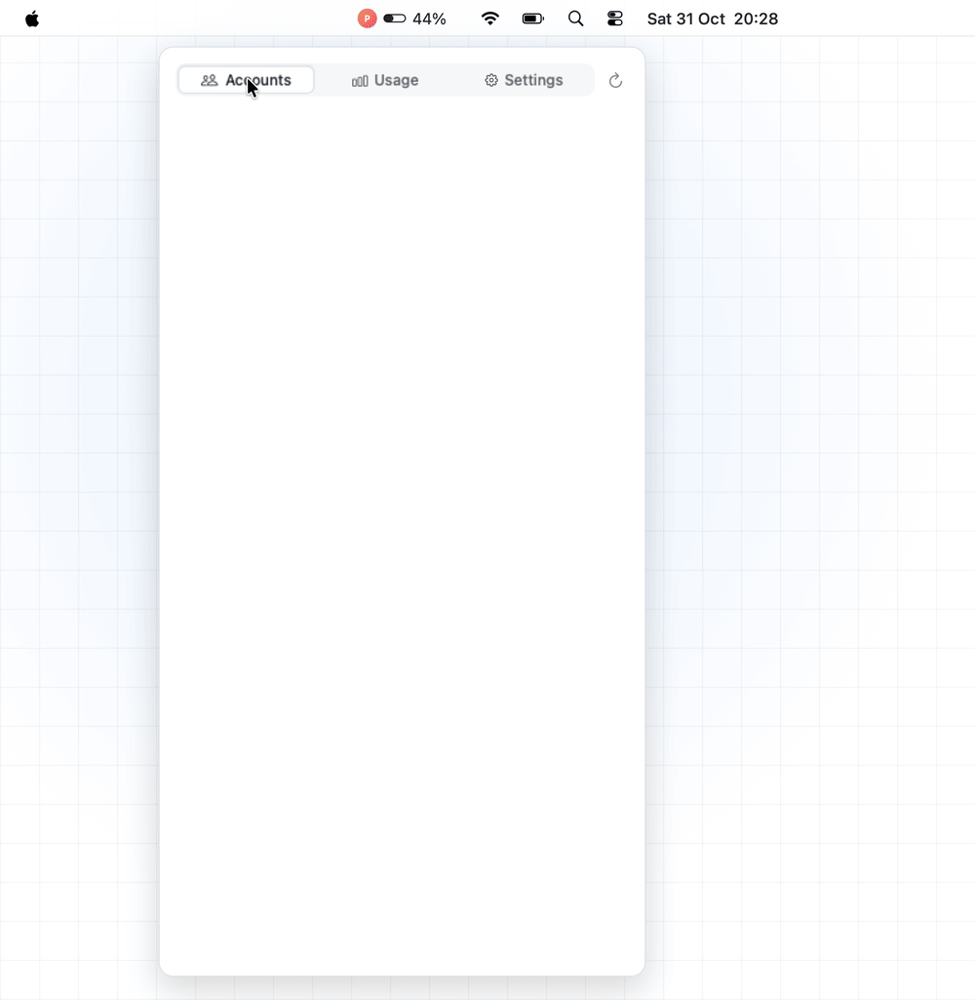
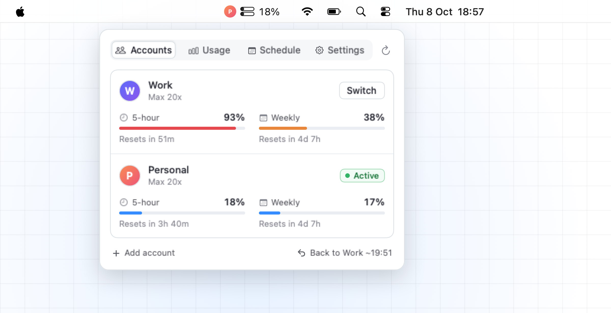
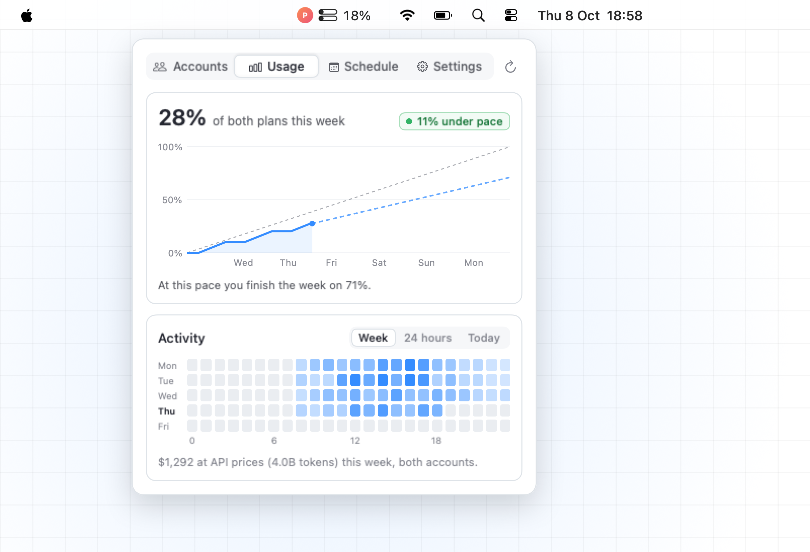
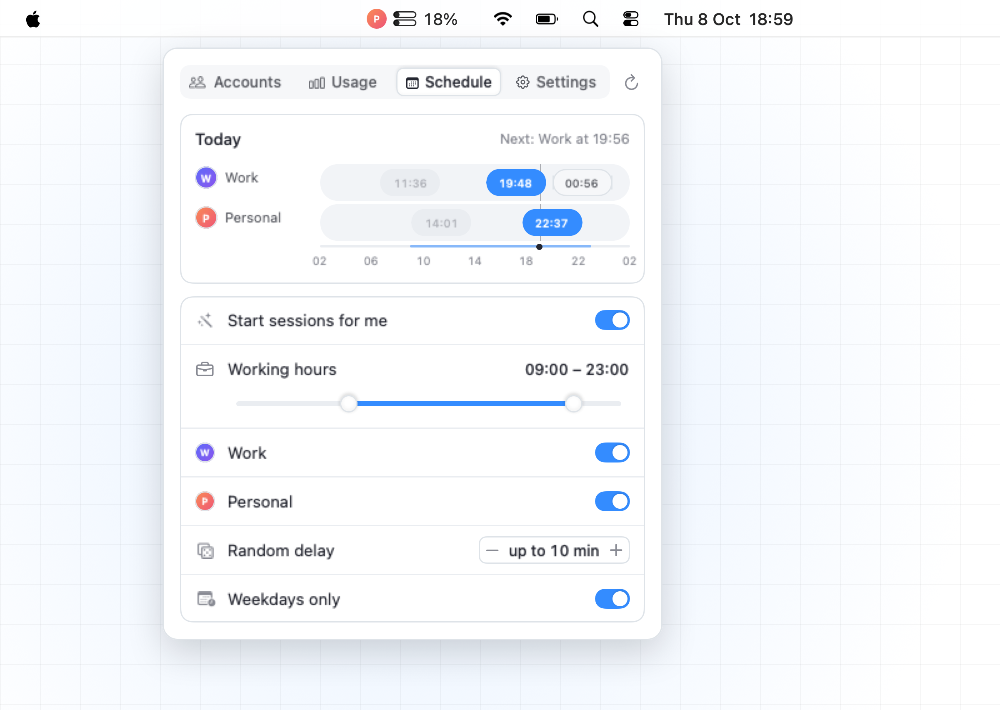
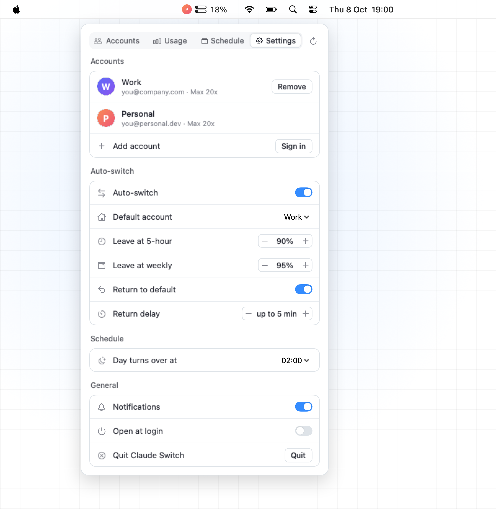

<p align="center">
  
</p>

<h1 align="center">Claude Switch</h1>

<p align="center">
  Run more than one Claude plan from your Mac's menu bar.<br>
  See every account's limits, switch the live login in one click, and let it switch and start your 5-hour windows for you.
</p>

<p align="center">
  <a href="https://itsnedthomas.github.io/claude-switch/">Website</a> ·
  <a href="#install">Install</a> ·
  <a href="#how-it-works">How it works</a>
</p>

<p align="center">
  
</p>

## Why

If you use Claude Code all day on two Max (or Pro) plans, you hit a 5-hour limit on one and have to log out, log in again in the browser, and lose your flow. Claude Switch keeps every account signed in and swaps which one Claude Code uses, in about a second, for every Claude Code session on your Mac at once: terminals, IDEs, Conductor workspaces.

## What it does

<table>
<tr>
<td width="50%"></td>
<td width="50%"></td>
</tr>
<tr>
<td>

**Accounts.** Each account's 5-hour and weekly limits, the way Claude's own usage page shows them. Bars are blue, orange when an account is on course to run close, red when it's on course to run out. Hover for the reset date and when it runs out at this pace. One click on **Switch** moves every Claude Code session to that account.

</td>
<td>

**Usage.** Every plan's weekly limit together, against an even pace, projected to the reset. Activity is your spend at API prices, read from Claude Code's own transcripts on your Mac, as a Mon–Fri heat map or by the hour for the last 24 hours or today.

</td>
</tr>
<tr>
<td width="50%"></td>
<td width="50%"></td>
</tr>
<tr>
<td>

**Schedule.** Set your working hours and it plans each account's 5-hour windows across the day, staggered so a fresh window opens every 5 hours ÷ accounts. "Start sessions for me" opens each window on time with a one-token message, a random minute or two late.

</td>
<td>

**Settings.** Auto-switch away from an account at a 5-hour or weekly limit you choose, and back to your default account a few random minutes after its window resets. Pictures, names, notifications, open at login.

</td>
</tr>
</table>

<p align="center">
  <br>
  <sub>The menu bar shows the live account's picture, its 5-hour (top) and weekly bars, and its 5-hour %.</sub>
</p>

## Install

Requires macOS 14 or later, the Xcode command line tools (`xcode-select --install`) and [Claude Code](https://docs.claude.com/en/docs/claude-code) signed in once.

```bash
git clone https://github.com/itsnedthomas/claude-switch.git
cd claude-switch
./build.sh --install    # builds, copies to /Applications and opens it
```

Or download the zipped app from [Releases](https://github.com/itsnedthomas/claude-switch/releases). It isn't notarised, so the first time, right-click it in Applications and choose **Open**.

The account Claude Code is signed in to shows up straight away. **Add account** signs another one in through your browser (if the browser opens on the wrong account, use *Switch account* at the bottom of Claude's page).

## How it works

- **One login slot.** Every Claude Code session on your Mac reads its login from the Keychain item `Claude Code-credentials`. Claude Switch keeps each account's login in its own Keychain item (`ClaudeSwitch`) and, on a switch, puts the other one in that slot, keeping any MCP logins stored beside it. Claude Code re-reads the slot about every 30 seconds, so running sessions move over by themselves.
- **Adding an account** runs `claude auth login` in a throwaway config folder, so the account you're on is never touched.
- **Usage** comes from the endpoint behind Claude Code's `/usage`, about every 5 minutes per account. When Anthropic throttles it, the app backs off and, for an account already inside a window, reads the same figures from a one-token reply's rate-limit headers.
- **Tokens.** Logins never leave your Keychain. The app refreshes the token of an account that isn't live; the live one is left to Claude Code.
- **Activity** is read from `~/.claude/projects` on your Mac and priced at public API rates. Nothing is uploaded.
- An event log of every switch is kept at `~/Library/Application Support/ClaudeSwitch/events.log`.

## Good to know

- The usage endpoint is undocumented and may change.
- Auto-switching and scheduled sessions use the accounts you pay for, the way you'd use them by hand. Whether that fits your plan is between you and Anthropic's terms; both features are opt-in.
- Not affiliated with or endorsed by Anthropic. "Claude" and the Claude mark are Anthropic's.

## Development

```bash
swift build                      # debug build
./build.sh                       # release .app in build/
./scripts/media.sh               # re-render docs/media from the real UI with demo data
```

`--demo` data is made up and nothing in it reads your accounts. The media pipeline renders each frame from the app's own SwiftUI views.

## License

MIT
